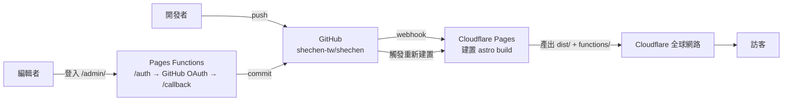

# shechen

`shechen` 品牌官方網站。靜態網站（Astro）部署在 Cloudflare Pages，內容由 Decap CMS 管理，內容來源為 GitHub 儲存庫 `shechen-tw/shechen`。語系為繁體中文（zh-TW）單一語系。

## 目前狀態

僅有工程骨架，尚未開發頁面與樣式（首頁為佔位頁）。

- 框架：Astro 5（`output: 'static'`）
- 主機：Cloudflare Pages（`wrangler.toml` + `functions/`）
- 內容管理：Decap CMS（`/admin/`）
- 套件管理：pnpm 9
- Node：20.x（見 `.nvmrc`）

## 需求

- Node.js 20.x
- pnpm 9.x（`corepack enable && corepack prepare pnpm@9.15.9 --activate`）

## 本機開發

```bash
pnpm install
cp .env.example .env   # 填入本機用的值
pnpm dev               # http://localhost:4321
```

其他指令：

| 指令                | 說明                                       |
| ------------------- | ------------------------------------------ |
| `pnpm dev`          | 啟動 Astro 開發伺服器                      |
| `pnpm cms`          | 啟動 decap-server（http://localhost:8081） |
| `pnpm check`        | `astro check` 型別檢查                     |
| `pnpm build`        | 產出 `dist/`                               |
| `pnpm preview`      | 建置後以 `wrangler pages dev` 本機預覽     |
| `pnpm deploy`       | 建置並部署到 Cloudflare Pages              |
| `pnpm format`       | Prettier 格式化                            |
| `pnpm format:check` | 檢查格式                                   |

在本機使用 CMS：終端機一開 `pnpm cms`，另一開 `pnpm dev`，再開 <http://localhost:4321/admin/>。`public/admin/config.yml` 的 `local_backend: true` 會讓 CMS 直接寫入本機檔案，不需要 GitHub 登入。

## 環境變數

本機放 `.env`（已 gitignore）；正式環境用 Cloudflare secret 或 Pages 後台環境變數。

| 變數                   | 用途                                      |
| ---------------------- | ----------------------------------------- |
| `GITHUB_CLIENT_ID`     | GitHub OAuth App 的 Client ID             |
| `GITHUB_CLIENT_SECRET` | GitHub OAuth App 的 Client Secret（機密） |
| `SITE_URL`             | 站台的 canonical URL                      |

機密只能用 `wrangler pages secret put` 或 Pages 後台設定，不進版控。

## 部署



### 初次部署

1. 在 Cloudflare Pages 建立專案，連到 GitHub 儲存庫 `shechen-tw/shechen`。
2. 建置設定：Framework preset `Astro`、Build command `pnpm build`、Output directory `dist`。
3. 在 Pages 專案設定 `GITHUB_CLIENT_ID`、`SITE_URL`，並以 secret 設定 `GITHUB_CLIENT_SECRET`：

   ```bash
   wrangler pages secret put GITHUB_CLIENT_SECRET --project-name shechen
   ```

4. 部署後把 `public/admin/config.yml` 的 `base_url`、`site_url`、`display_url` 換成正式網域。

### GitHub OAuth App

Decap CMS 需要 OAuth proxy 才能登入：

1. <https://github.com/settings/developers> → New OAuth App。
2. Homepage URL 填站台網址。
3. **Authorization callback URL 必須是 `<站台網址>/callback`**。
4. 把 Client ID／Secret 設到環境變數（見上）。

OAuth 流程由 `functions/auth.ts`（導向 GitHub）與 `functions/callback.ts`（換 token 並以 `postMessage` 交回 CMS）實作，並以 state cookie 防 CSRF。

## 內容管理（/admin/）

1. 前往 `<站台網址>/admin/`，以具有儲存庫權限的 GitHub 帳號登入。
2. 選擇「頁面」或「網站設定」編輯內容。
3. `publish_mode: editorial_workflow` 已啟用：存檔後進入 Draft／In review，需在 CMS 介面按 Publish 才合併並觸發部署。
4. 圖片上傳到 `public/uploads`，前台路徑為 `/uploads/...`。

## 目錄結構

```
functions/          Cloudflare Pages Functions（OAuth proxy）
public/admin/       Decap CMS 入口與設定
src/content/        內容集合（pages、settings）
src/pages/          頁面
docs/               交接與規則文件（含 `domains-and-naming.md`）
```

## CI

`.github/workflows/ci.yml` 在 push／PR 時執行 `pnpm install --frozen-lockfile`、`pnpm check`、`pnpm build`。
