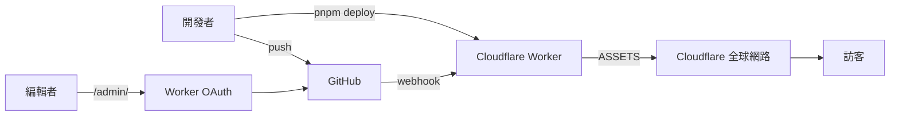

# 雪謙（台灣）官方網站

雪謙（台灣）官方網站原始碼。靜態網站，Astro 建置後由 Cloudflare Workers 提供，內容經 Decap CMS 管理，來源為 GitHub 儲存庫 `shechen-tw/shechen`。

- 語系：繁體中文（zh-TW）單一語系
- 目前為工程骨架，頁面與樣式尚未開發，首頁為佔位頁（已加 `noindex`）

## 需求

- Node.js 24.x（見 `.nvmrc`）
- pnpm 12.x（`corepack enable && corepack prepare pnpm@12.23.0 --activate`）

## 部署

`main` 受分支保護，一律開 PR 合併。部署由 Cloudflare Workers 執行，完整步驟見 [`docs/deployment.md`](docs/deployment.md)。



部署前必做：

```bash
pnpm format:check && pnpm check && pnpm build
npx wrangler deploy --dry-run
```

## 文件

| 文件                                                       | 內容                   |
| ---------------------------------------------------------- | ---------------------- |
| [`docs/development.md`](docs/development.md)               | 本機開發與指令         |
| [`docs/environment.md`](docs/environment.md)               | 環境變數與 secret      |
| [`docs/deployment.md`](docs/deployment.md)                 | 部署與 GitHub App 設定 |
| [`docs/content-management.md`](docs/content-management.md) | `/admin/` 使用方式     |
| [`docs/domains-and-naming.md`](docs/domains-and-naming.md) | 網域與 Worker 命名規則 |
| [`docs/contributing.md`](docs/contributing.md)             | 分支保護、PR 流程、CI  |
| [`docs/project-structure.md`](docs/project-structure.md)   | 目錄結構               |
