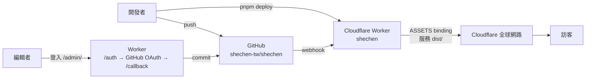

# shechen

`shechen` 品牌官方網站。靜態網站（Astro）部署在 Cloudflare Workers（Static Assets），內容由 Decap CMS 管理，內容來源為 GitHub 儲存庫 `shechen-tw/shechen`。語系為繁體中文（zh-TW）單一語系。

## 目前狀態

僅有工程骨架，尚未開發頁面與樣式（首頁為佔位頁，已加 `noindex`）。

- 框架：Astro 7（`output: 'static'`），產出 `dist/` 由 Worker 以靜態資源提供
- 主機：Cloudflare Workers（`wrangler.toml` + `src/worker.ts`）
- 內容管理：Decap CMS（`/admin/`）
- 套件管理：pnpm 12
- Node：24.x（見 `.nvmrc`，為 Cloudflare 建置映像預設值）

## 需求

- Node.js 24.x（見 `.nvmrc`）
- pnpm 12.x（`corepack enable && corepack prepare pnpm@12.23.0 --activate`）

## 本機開發

```bash
pnpm install
cp .env.example .dev.vars   # 填入本機用的值（wrangler dev 會讀取）
pnpm dev                    # http://localhost:4321
```

其他指令：

| 指令                | 說明                                       |
| ------------------- | ------------------------------------------ |
| `pnpm dev`          | 啟動 Astro 開發伺服器                      |
| `pnpm cms`          | 啟動 decap-server（http://localhost:8081） |
| `pnpm check`        | `astro check` + Worker 型別檢查            |
| `pnpm build`        | 產出 `dist/`                               |
| `pnpm preview`      | 建置後以 `wrangler dev` 本機預覽           |
| `pnpm deploy`       | 建置並部署到 Cloudflare Workers            |
| `pnpm format`       | Prettier 格式化                            |
| `pnpm format:check` | 檢查格式                                   |

在本機使用 CMS：終端機一開 `pnpm cms`，另一開 `pnpm dev`，再開 <http://localhost:4321/admin/>。`public/admin/config.yml` 的 `local_backend: true` 會讓 CMS 直接寫入本機檔案，不需要 GitHub 登入。

## 環境變數

本機放 `.dev.vars`（已 gitignore）；正式環境用 `wrangler secret` 或 Worker 後台環境變數。

| 變數                   | 用途                                      |
| ---------------------- | ----------------------------------------- |
| `GITHUB_CLIENT_ID`     | GitHub OAuth App 的 Client ID             |
| `GITHUB_CLIENT_SECRET` | GitHub OAuth App 的 Client Secret（機密） |
| `SITE_URL`             | 站台的 canonical URL                      |

機密只能用 `wrangler secret put` 或後台設定，不進版控。

## 部署



請求優先由靜態資源回應，只有 `/auth` 與 `/callback` 會先進入 Worker（`run_worker_first`）。

> 版本一致性：本專案以 Node 24 LTS 為基準，正好是 Workers Builds 建置映像的預設版本。若日後調高 `.nvmrc`，記得在 Worker 的 Settings → Build → Build Variables 設定 `NODE_VERSION`，避免雲端與本機不一致。

### 初次部署

1. 登入 Wrangler：`npx wrangler login`。
2. 設定非機密變數（可在 `wrangler.toml` 的 `[vars]`，或後台設定），機密用 secret：

   ```bash
   npx wrangler secret put GITHUB_CLIENT_SECRET
   ```

3. `pnpm deploy`，首次會建立名為 `shechen` 的 Worker，網址形如 `https://shechen.<帳號子網域>.workers.dev`。
4. 把實際網址填入 `public/admin/config.yml` 的 `base_url`、`site_url`、`display_url`。
5. 接上 GitHub（Workers Builds 或 GitHub Actions）以在 push 時自動部署。

### GitHub OAuth App

Decap CMS 需要 OAuth proxy 才能登入：

1. <https://github.com/settings/developers> → New OAuth App。
2. Homepage URL 填站台網址。
3. **Authorization callback URL 必須是 `<站台網址>/callback`**。
4. 把 Client ID／Secret 設到環境變數（見上）。

OAuth 流程由 `src/worker.ts` 的 `handleAuth`（導向 GitHub）與 `handleCallback`（驗證 state、換 token 並以 `postMessage` 交回 CMS）實作。

## 內容管理（/admin/）

1. 前往 `<站台網址>/admin/`，以具有儲存庫權限的 GitHub 帳號登入。
2. 選擇「頁面」或「網站設定」編輯內容。
3. `publish_mode: editorial_workflow` 已啟用：存檔後進入 Draft／In review，需在 CMS 介面按 Publish 才合併並觸發部署。
4. 圖片上傳到 `public/uploads`，前台路徑為 `/uploads/...`。

## 目錄結構

```
src/worker.ts       Worker 入口（OAuth proxy，其餘交 ASSETS）
public/admin/       Decap CMS 入口與設定
src/content/        內容集合（頁面 md、設定 yml）
src/content.config.ts 內容集合 schema 與 loader
src/pages/          頁面
docs/               交接與規則文件（含 `domains-and-naming.md`）
```

## CI

`.github/workflows/ci.yml` 在 push／PR 時執行 `pnpm install --frozen-lockfile`、`pnpm check`、`pnpm build`，並以 `wrangler deploy --dry-run` 驗證 Worker 設定。
