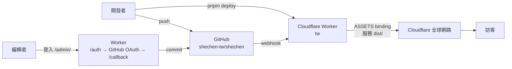

# 部署

## 架構



請求優先由靜態資源回應，只有 `/auth` 與 `/callback` 會先進入 Worker（`run_worker_first`）。

## 前置

- Cloudflare 帳號並完成 `npx wrangler login`
- GitHub OAuth App（見下節）
- 網域決策完成（見 `domains-and-naming.md`）

## 步驟

1. 設定機密：

   ```bash
   npx wrangler secret put GITHUB_CLIENT_SECRET
   ```

2. 設定 `GITHUB_CLIENT_ID`、`SITE_URL`（`wrangler.toml` 的 `[vars]` 或後台）。
3. `pnpm deploy`，Worker 名稱為 `tw`，網址 `https://tw.shechen.workers.dev`。
4. 取得網址後填入 `public/admin/config.yml` 的 `base_url`、`site_url`、`display_url` 並重新部署。
5. 接上 Workers Builds（連 GitHub、建置指令 `pnpm build`），之後 push 即自動部署。

## GitHub App（OAuth）

使用 GitHub App 而非 OAuth App：權限是細粒度的，且可鎖定單一組織與單一 repo。

App 必須註冊在**組織**底下，不是個人帳號：

1. <https://github.com/organizations/shechen-tw/settings/apps/new>
2. Homepage URL `https://tw.shechen.workers.dev`，Callback URL `https://tw.shechen.workers.dev/callback`。
3. 取消 **Expire user authorization tokens**（Decap 不會 refresh，勾選會導致每 8 小時被登出）。
4. 勾選 **Request user authorization (OAuth) during installation**。
5. 取消 **Webhook** 的 Active。
6. 權限只給：Contents `Read and write`、Pull requests `Read and write`、Metadata `Read`。其餘 No access。
7. **Where can this GitHub App be installed** 選 **Only on this account**（即 `shechen-tw`）。
8. 左側 Install App → 選 `shechen-tw` → **Only select repositories** → 只勾 `shechen`。
9. 複製 Client ID、Generate a client secret。

建議再到 <https://github.com/organizations/shechen-tw/settings/installations> 把 GitHub App access 設為需 owner 核准。

### 程式層硬鎖

`wrangler.toml` 的 `GITHUB_REPOSITORY_ID`（目前 `1469486652`）會在換 token 時一併帶上，即使日後安裝範圍放寬，token 仍只綁這一個 repo。

### 權限變更

App 權限改了之後**必須重新安裝**（Settings → Installations → Configure → 重新確認 repo）才會生效。

## 版本一致性

專案以 Node 24 LTS 為基準，正好是 Workers Builds 建置映像的預設版本。若日後調高 `.nvmrc`，需在 Worker 的 Settings → Build → Build Variables 設 `NODE_VERSION`。

## 部署前檢查

```bash
pnpm format:check
pnpm check
pnpm build
npx wrangler deploy --dry-run
```

## 回滾

Worker → Deployments 選擇先前的版本重新部署；或 `git revert` 後走 PR。
