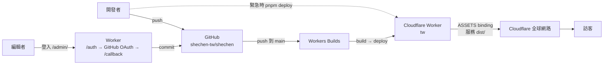

# 部署

## 架構



請求優先由靜態資源回應，只有 `/auth` 與 `/callback` 會先進入 Worker（`run_worker_first`）。

## 前置

- Cloudflare 帳號並完成 `npx wrangler login`
- GitHub App（見下節）
- 網域決策完成（見 `domains-and-naming.md`）

## 步驟

1. 設定機密：

   ```bash
   npx wrangler secret put GITHUB_CLIENT_SECRET
   ```

2. 設定 `GITHUB_CLIENT_ID`、`SITE_URL`（`wrangler.toml` 的 `[vars]` 或後台）。
3. `pnpm deploy`，Worker 名稱為 `tw`，網址 `https://tw.shechen.workers.dev`。
4. 取得網址後填入 `public/admin/config.yml` 的 `base_url`、`site_url`、`display_url` 並重新部署。
5. 接上 Workers Builds（見下節），之後合併 PR 即自動部署。

## Workers Builds

讓「`main` 有新 commit → 自動建置 → 部署」成立，Decap 發布才會真的上線。Workers Builds 是 Cloudflare 內建功能，不需要另寫部署用 CI。

### 設定

只能從後台設定：`wrangler` 沒有對應指令，`wrangler login` 的 OAuth token 也缺 Workers Builds 權限（直接打 API 會回 `Authentication error`）。要自動化得另建帶 `Workers Builds:Edit` 的 API token。

Worker `tw` → Settings → **Build** → **Connect repository**：

1. 儲存庫 `shechen-tw/shechen`，production 分支 `main`。
2. Build command：`corepack enable && pnpm install --frozen-lockfile && pnpm build`
3. Deploy command：`npx wrangler deploy`
4. Build variables 加 `NODE_VERSION=24`。建置映像的預設 Node 版本會隨時間變動，不鎖版本的話 `.nvmrc` 與實際執行環境可能不一致。
5. Path excludes 填 `docs/**`、`README.md`，純文件變更不浪費建置分鐘。**不要填 `*.md`**，理由見「Path excludes 不能擋掉 `*.md`」。
6. Root directory 留空。
7. 非 production 分支建置**關閉**，理由見「為什麼關閉分支預覽」。

### 指令為什麼是 pnpm

repo 是 pnpm workspace（`packageManager: pnpm@12.23.0`、`pnpm-workspace.yaml`）。換成 `npm run build` 會讓 `pnpm-workspace.yaml` 的 `minimumReleaseAge`、`allowBuilds` 失效，也不讀 `pnpm-lock.yaml`。

Build command 必須自己帶 `pnpm install`。Workers Builds 只執行你填的指令，不會自動安裝依賴。

### 與 `ci.yml` 的分工

`.github/workflows/ci.yml` 不負責部署，但仍然必要：

- ruleset `protect-main` 的 required status check 名稱就是 `build`，由 `ci.yml` 產生。Workers Builds 的 check 是不同 context，不會滿足它。
- `ci.yml` 會跑 `pnpm check` 與 `wrangler deploy --dry-run`；Workers Builds 只跑 build 與 deploy，不做型別檢查。

### 不要加 `[build]`

`wrangler.toml` 保持沒有 `[build]` 區塊。`wrangler deploy` 本身就會先跑 Worker 的建置流程，加了會變成重複建置。

### 為什麼關閉分支預覽

開啟時，非 production 分支的建置不會動到正式站：Workers Builds 會自動把 deploy 換成 `wrangler preview`，產生獨立的 Preview 版本與網址，Deploy command 不用改。

問題是 preview 名稱直接取自分支名，而 preview 名稱只接受英數與 `- _ / . + =`。Decap 的分支名是 `cms/<集合>/<slug>`，slug 預設保留中文，所以每個中文標題的分支都會在開始建置前就失敗：

```
Preview creation failed: Invalid preview name: name must start and end with
  alphanumeric characters and may only contain alphanumeric characters and - _ / . + =
```

改成 ASCII slug 可以救，但要付代價：中文標題會被洗成空字串，所以 `slug` 得加日期前綴，檔名與網址就變成 `2026-11-24.md`、`/2026-11-24/`，認不出是哪一頁。

因此取捨是：**關閉非 production 分支建置，保留中文檔名與中文網址**。PR 把關改由 `ci.yml` 的 `build` 負責（它會真的跑 `pnpm build`），內容排版則用 CMS 編輯畫面右側的預覽窗格看。壞掉的草稿仍然碰不到正式版——草稿只是 commit 到 `cms/` 分支並開 PR。

關閉後 `[previews.vars]` 用不到，但留著無害，之後若改走 ASCII slug 就能直接打開：

```toml
[previews.vars]
SITE_URL = "https://tw.shechen.workers.dev"
GITHUB_REPOSITORY_ID = "1469486652"
```

值刻意與正式環境相同：repo 鎖要在預覽也生效，OAuth 也才能對到同一個 callback。

Preview 的 secret 是另一套，正式環境的 `GITHUB_CLIENT_SECRET` 不會帶過去。所以在預覽上 `/admin/` 登入會失敗；要驗證登入相關改動，得跑 `npx wrangler preview secret put GITHUB_CLIENT_SECRET` 或在正式站驗。

### Path excludes 不能擋掉 `*.md`

內容就是 markdown。`*.md` 會連 `src/content/**` 一起排掉，結果是：發稿的 commit 只有一個 `.md`，建置被跳過，站上不會更新；GitHub 上只會留下一個永遠停在 queued 的 Cloudflare check suite，看起來像沒觸發，其實是被篩掉了。

所以要排除的只有文件：`docs/**`、`README.md`。若之後把 `src/`、`public/` 也排除，同樣會漏掉真正需要上線的變更。

要確認排除清單還有效，就看一次發稿後的 commit 有沒有跑建置；沒有就是清單太寬。

### 維運注意

- `wrangler.toml` 的 `[vars]`（`GITHUB_CLIENT_ID`、`SITE_URL`）是 source of truth，每次部署都會覆蓋後台改的值。要改就改 `wrangler.toml`。
- `GITHUB_CLIENT_SECRET` 是 Worker 上的 secret，重新部署不會清掉，別加進 Build variables。
- 部署身分是 Cloudflare 的 GitHub 整合，與 `shechen-cms` App 是兩套獨立授權：撤銷其中一邊不會影響另一邊，要收掉得兩邊都處理。
- 建置失敗網站不會壞，舊版繼續服務。到 Worker → Deployments → build history 看 log。

沒有接 Workers Builds 時，合併 PR 後線上不會跟著更新，必須有人在本機跑 `pnpm deploy`。

## GitHub App（OAuth）

使用 GitHub App 而非 OAuth App：權限是細粒度的，且可鎖定單一組織與單一 repo。

App 必須註冊在**組織**底下，不是個人帳號：

1. <https://github.com/organizations/shechen-tw/settings/apps/new>
2. Homepage URL `https://tw.shechen.workers.dev`，Callback URL `https://tw.shechen.workers.dev/callback`。
3. 取消 **Expire user authorization tokens**（Decap 不會 refresh，勾選會導致每 8 小時被登出）。
4. 勾選 **Request user authorization (OAuth) during installation**。
5. 取消 **Webhook** 的 Active。
6. 權限只給：Contents `Read and write`、Pull requests `Read and write`、Metadata `Read`。其餘 No access。
7. **Where can this GitHub App be installed** 選 **Only on this account**（即 `shechen-tw`）。
8. 左側 Install App → 選 `shechen-tw` → **Only select repositories** → 只勾 `shechen`。
9. 複製 Client ID、Generate a client secret。

### 安裝審核

組織 Settings → **Third-party Access** → **GitHub Apps** → 勾選 **Require approval for GitHub App access**。

這項是 UI-only 設定，REST 與 GraphQL 都沒有對應欄位，只能人工開啟與確認。開啟前，權限限制只保護這一個 App：若有人在組織裡裝了別的 App，可以直接取得遠比 `contents: write` 更廣的權限，而 owner 不會被通知。開啟後任何新安裝都必須由 owner 核可才生效。

現況：已開啟。

### 程式層硬鎖

`wrangler.toml` 的 `GITHUB_REPOSITORY_ID`（目前 `1469486652`）會在換 token 時一併帶上，即使日後安裝範圍放寬，token 仍只綁這一個 repo。

### 權限變更

App 權限改了之後**必須重新安裝**（Settings → Installations → Configure → 重新確認 repo）才會生效。

## 版本一致性

專案以 Node 24 LTS 為基準，正好是 Workers Builds 建置映像的預設版本。建置變數 `NODE_VERSION` 的設定見上節。

## 部署前檢查

```bash
pnpm format:check
pnpm check
pnpm build
npx wrangler deploy --dry-run
```

## 回滾

Worker → Deployments 選前一個正常版本 rollback，不要用 `wrangler rollback`（它不保證挑到好的版本）。同時 `git revert` 走 PR，否則下次 push 會把壞掉的版本再部署回來。
