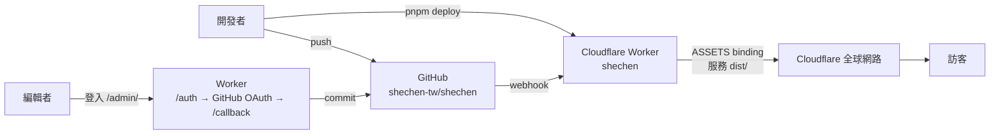

# 部署

## 架構



請求優先由靜態資源回應，只有 `/auth` 與 `/callback` 會先進入 Worker（`run_worker_first`）。

## 前置

- Cloudflare 帳號並完成 `npx wrangler login`
- GitHub OAuth App（見下節）
- 網域決策完成（見 `domains-and-naming.md`）

## 步驟

1. 設定機密：

   ```bash
   npx wrangler secret put GITHUB_CLIENT_SECRET
   ```

2. 設定 `GITHUB_CLIENT_ID`、`SITE_URL`（`wrangler.toml` 的 `[vars]` 或後台）。
3. `pnpm deploy`，首次會建立名為 `shechen` 的 Worker。
4. 取得網址後填入 `public/admin/config.yml` 的 `base_url`、`site_url`、`display_url` 並重新部署。
5. 接上 Workers Builds（連 GitHub、建置指令 `pnpm build`），之後 push 即自動部署。

## GitHub OAuth App

1. <https://github.com/settings/developers> → New OAuth App。
2. Homepage URL 填站台網址。
3. **Authorization callback URL 必須是 `<站台網址>/callback`**。
4. 把 Client ID／Secret 設到環境變數。

OAuth 流程由 `src/worker.ts` 的 `handleAuth` 與 `handleCallback` 實作，後者會驗證 state cookie 才換 token。

## 版本一致性

專案以 Node 24 LTS 為基準，正好是 Workers Builds 建置映像的預設版本。若日後調高 `.nvmrc`，需在 Worker 的 Settings → Build → Build Variables 設 `NODE_VERSION`。

## 部署前檢查

```bash
pnpm format:check
pnpm check
pnpm build
npx wrangler deploy --dry-run
```

## 回滾

Worker → Deployments 選擇先前的版本重新部署；或 `git revert` 後走 PR。
