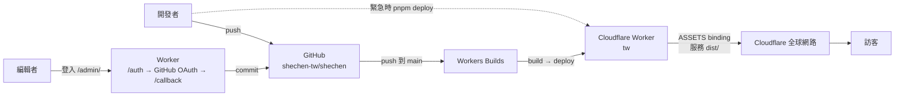

# 部署

## 架構



請求優先由靜態資源回應，只有 `/auth` 與 `/callback` 會先進入 Worker（`run_worker_first`）。

## 前置

- Cloudflare 帳號並完成 `npx wrangler login`
- GitHub App（見下節）
- 網域決策完成（見 `domains-and-naming.md`）

## 步驟

1. 設定機密：

   ```bash
   npx wrangler secret put GITHUB_CLIENT_SECRET
   ```

2. 設定 `GITHUB_CLIENT_ID`、`SITE_URL`（`wrangler.toml` 的 `[vars]` 或後台）。
3. `pnpm deploy`，Worker 名稱為 `tw`，網址 `https://tw.shechen.workers.dev`。
4. 取得網址後填入 `public/admin/config.yml` 的 `base_url`、`site_url`、`display_url` 並重新部署。
5. 接上 Workers Builds（見下節），之後合併 PR 即自動部署。

## Workers Builds

連上 GitHub 後，`main` 一有 push 就自動建置與部署，CMS 發布才能真的上線。

Worker `tw` → Settings → **Build** → Connect repository：

1. 儲存庫選 `shechen-tw/shechen`，分支 `main`。
2. Build command：`corepack enable && pnpm install --frozen-lockfile && pnpm build`。
3. Deploy command：`npx wrangler deploy`。
4. Build variables 設定 `NODE_VERSION=24`。建置映像的預設 Node 版本會隨時間變動，不鎖版本的話 `.nvmrc` 與實際執行環境可能不一致。
5. 取消非正式分支的部署，只讓 `main` 上線。

注意事項：

- Build command 要自己包含 `pnpm install`。Workers Builds 只會執行你填的指令，不會自動安裝依賴。
- 不要同時在 `wrangler.toml` 加 `[build]`：`wrangler deploy` 會自己再跑一次，變成重複建置。
- `GITHUB_CLIENT_SECRET` 是 Worker 上的 secret，重新部署不會清掉，不需在 Build variables 重設。
- 部署身分是 Cloudflare 內的整合，不需要任何人的 API token 存在 repo。

沒有接 Workers Builds 時，合併 PR 後線上不會跟著更新，必須有人在本機跑 `pnpm deploy`。

## GitHub App（OAuth）

使用 GitHub App 而非 OAuth App：權限是細粒度的，且可鎖定單一組織與單一 repo。

App 必須註冊在**組織**底下，不是個人帳號：

1. <https://github.com/organizations/shechen-tw/settings/apps/new>
2. Homepage URL `https://tw.shechen.workers.dev`，Callback URL `https://tw.shechen.workers.dev/callback`。
3. 取消 **Expire user authorization tokens**（Decap 不會 refresh，勾選會導致每 8 小時被登出）。
4. 勾選 **Request user authorization (OAuth) during installation**。
5. 取消 **Webhook** 的 Active。
6. 權限只給：Contents `Read and write`、Pull requests `Read and write`、Metadata `Read`。其餘 No access。
7. **Where can this GitHub App be installed** 選 **Only on this account**（即 `shechen-tw`）。
8. 左側 Install App → 選 `shechen-tw` → **Only select repositories** → 只勾 `shechen`。
9. 複製 Client ID、Generate a client secret。

### 安裝審核

組織 Settings → **Third-party Access** → **GitHub Apps** → 勾選 **Require approval for GitHub App access**。

這項是 UI-only 設定，REST 與 GraphQL 都沒有對應欄位，只能人工開啟與確認。開啟前，權限限制只保護這一個 App：若有人在組織裡裝了別的 App，可以直接取得遠比 `contents: write` 更廣的權限，而 owner 不會被通知。開啟後任何新安裝都必須由 owner 核可才生效。

現況：已開啟。

### 程式層硬鎖

`wrangler.toml` 的 `GITHUB_REPOSITORY_ID`（目前 `1469486652`）會在換 token 時一併帶上，即使日後安裝範圍放寬，token 仍只綁這一個 repo。

### 權限變更

App 權限改了之後**必須重新安裝**（Settings → Installations → Configure → 重新確認 repo）才會生效。

## 版本一致性

專案以 Node 24 LTS 為基準，正好是 Workers Builds 建置映像的預設版本。建置變數 `NODE_VERSION` 的設定見上節。

## 部署前檢查

```bash
pnpm format:check
pnpm check
pnpm build
npx wrangler deploy --dry-run
```

## 回滾

Worker → Deployments 選擇先前的版本重新部署；或 `git revert` 後走 PR。
