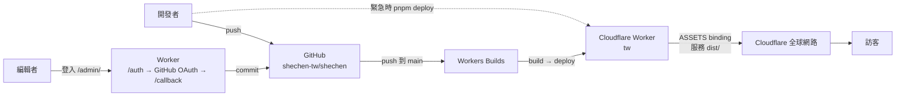

# 部署

## 架構



請求優先由靜態資源回應，只有 `/auth` 與 `/callback` 會先進入 Worker（`run_worker_first`）。

## 前置

- Cloudflare 帳號並完成 `npx wrangler login`
- GitHub App（見下節）
- 網域決策完成（見 `domains-and-naming.md`）

## 步驟

1. 設定機密：

   ```bash
   npx wrangler secret put GITHUB_CLIENT_SECRET
   ```

2. 設定 `GITHUB_CLIENT_ID`、`SITE_URL`（`wrangler.toml` 的 `[vars]` 或後台）。
3. `pnpm deploy`，Worker 名稱為 `tw`，網址 `https://tw.shechen.workers.dev`。
4. 取得網址後填入 `public/admin/config.yml` 的 `base_url`、`site_url`、`display_url` 並重新部署。
5. 接上 Workers Builds（見下節），之後合併 PR 即自動部署。

## Workers Builds

`main` 有新 commit 時自動建置並部署。只能在後台設定，`wrangler` 沒有對應指令。

Worker `tw` → Settings → **Build** → **Connect repository**：

1. 儲存庫 `shechen-tw/shechen`，production 分支 `main`。
2. Build command：`corepack enable && pnpm install --frozen-lockfile && pnpm build`。必須用 pnpm，且必須自己帶 `pnpm install`。
3. Deploy command：`npx wrangler deploy`
4. Build variables 加 `NODE_VERSION=24`。
5. Include paths 保持 `*`；Excludes 填 `docs/*`、`README.md`。
6. Root directory 留空。
7. Settings → **Build** → **Branch control** → 取消勾選 `Enable preview builds`。

### `ci.yml`

`.github/workflows/ci.yml` 不負責部署，必須保留：

- ruleset `protect-main` 的 required status check 名稱是 `build`，只有它能產生。
- 它會跑 `pnpm check` 與 `wrangler deploy --dry-run`。

`wrangler.toml` 不要加 `[build]` 區塊。

### 分支預覽

非 production 分支的建置走 `wrangler preview`，Preview 名稱取自分支名，只接受英數與 `- _ / . + =`。Decap 的分支名含中文，因此關閉。關閉後 PR 上只有 `ci.yml` 的 `build`。

`wrangler.toml` 保留 `[previews.vars]`，重開預覽時需要：

```toml
[previews.vars]
SITE_URL = "https://tw.shechen.workers.dev"
GITHUB_REPOSITORY_ID = "1469486652"
```

Preview 的 secret 是另一套，要在預覽上登入 `/admin/` 得先 `npx wrangler preview secret put GITHUB_CLIENT_SECRET`。

### Build watch paths

Include paths 保持 `*`，Excludes 只填 `docs/*`、`README.md`。

`*.md` 不可放進 Excludes：內容本身是 markdown，會連 `src/content/**` 一起排掉，發稿後不會建置。`src/`、`public/` 同樣不可排除。

### 維運注意

- `[vars]` 以 `wrangler.toml` 為準，每次部署都覆蓋後台值。
- `GITHUB_CLIENT_SECRET` 是 Worker 上的 secret，不要加進 Build variables。
- 部署身分（Cloudflare GitHub 整合）與 `shechen-cms` App 是兩套授權，收掉要兩邊都處理。
- 建置失敗不影響線上，舊版繼續服務；log 在 Worker → Deployments → build history。

## GitHub App（OAuth）

App 必須註冊在**組織**底下，不是個人帳號：

1. <https://github.com/organizations/shechen-tw/settings/apps/new>
2. Homepage URL `https://tw.shechen.workers.dev`，Callback URL `https://tw.shechen.workers.dev/callback`。
3. 取消 **Expire user authorization tokens**。
4. 勾選 **Request user authorization (OAuth) during installation**。
5. 取消 **Webhook** 的 Active。
6. 權限只給：Contents `Read and write`、Pull requests `Read and write`、Metadata `Read`。其餘 No access。
7. **Where can this GitHub App be installed** 選 **Only on this account**（即 `shechen-tw`）。
8. 左側 Install App → 選 `shechen-tw` → **Only select repositories** → 只勾 `shechen`。
9. 複製 Client ID、Generate a client secret。

### 安裝審核

組織 Settings → **Third-party Access** → **GitHub Apps** → 勾選 **Require approval for GitHub App access**。UI-only，只能人工設定。現況：已開啟。

### 程式層硬鎖

`wrangler.toml` 的 `GITHUB_REPOSITORY_ID`（目前 `1469486652`）會在換 token 時一併帶上，token 只綁這一個 repo。

### 權限變更

App 權限改了之後必須重新安裝（Settings → Installations → Configure → 重新確認 repo）才會生效。

## 版本

Node 24 LTS，見 `.nvmrc` 與建置變數 `NODE_VERSION`。

## 部署前檢查

```bash
pnpm format:check
pnpm check
pnpm build
npx wrangler deploy --dry-run
```

## 回滾

Worker → Deployments 選前一個正常版本 rollback，不要用 `wrangler rollback`。同時 `git revert` 走 PR。
